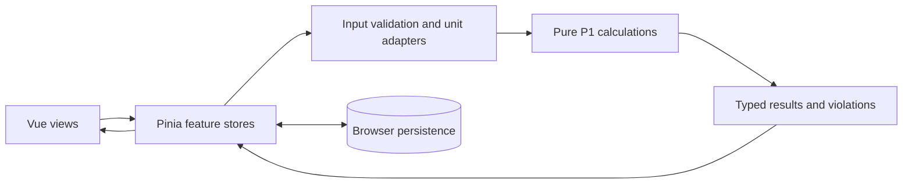

# AeroDash architecture

AeroDash is a frontend-only Vue 3 PWA using strict TypeScript, Pinia, Vue Router and Vite. Aircraft profiles persist in IndexedDB; active preparation payload and preferences also use browser storage. See [data rights](docs/architecture/data-rights.md) and [PRIVACY.md](PRIVACY.md) for the concrete storage surface. No backend is required by the current app.

## Data flow and boundaries

| Tier | Location | Responsibility |
| :--- | :--- | :--- |
| P1 | `frontend/src/core/` | Zod schemas, domain contracts, units and deterministic M&B/performance/fuel logic |
| P2 | `frontend/src/modules/` | Aircraft and preparation features, stores and input/output adapters |
| P3 | `frontend/src/shared/`, global `stores/`, `plugins/`, `router/`, app views | Navigation, shared components and application services |

P1 imports only core, standard-library APIs and Zod. It returns typed results; upper layers render warnings and enforce acknowledgement. P2 must not depend on shell implementations. See [dependency isolation](docs/architecture/adr/314-DEV-dependency-isolation.md) and [contributor rules](AGENTS.md).

## Local profiles and preparation

[Aircraft model](docs/architecture/aircraft_data_model.md), [fleet module](docs/architecture/aircraft-fleet-module.md) and [exchange contract](docs/architecture/aircraft-exchange-file-format.md) describe schema validation, immutable verified snapshots, draft edits, provenance/expiry and import/export boundaries. [Optional occupancy](docs/architecture/optional-occupancy.md) distinguishes a legitimate empty seat from invalid or missing occupant mass.

Profiles preserve manufacturer source units. [Performance source units](docs/architecture/performance-source-units.md) are declared per table and axis independently of M&B; original points persist and the pure adapter normalizes copies for review and lookup. Adapters normalize values to the internal calculation frame (kg, m, L, s as applicable); pressure-altitude lookup uses ft and temperature uses °C under its explicit contract. Calculations must not mix units implicitly. The original POH/weighing report remains authoritative.

## Numerical contracts and evidence

- [M&B requirements](docs/requirements/mass_balance.md) cover category limits, CG/envelope checks, variable station moments and fuel-burn migration.
- [Interpolation](docs/architecture/performance-bilinear-interpolation-contract.md) defines the regular-grid lookup, clamping flags and hand-computed test vectors.
- [Extrapolation](docs/architecture/performance-extrapolation-control.md) defines the 10% cap, single 20% penalty, minimum-distance floor and acknowledgement boundary.
- [Safety-factor pipeline](docs/architecture/performance-safety-factor-pipeline.md) defines ground versus airborne correction, presets, margins and failures. Preset names are software behavior, not a claim that a factor is applicable to every operation.
- [Notifications](docs/architecture/notification_schema.md) separate input-validation ERRORs from flight-limit CRITICALs.

Core source/tests do not prove an integrated UI path or operational data validity. The P2 Performance inspection service validates persisted profiles, complete positive grids, decimal input and the common envelope before invoking the core; any clamping blocks output. Fleet exposes imported points for review. [Manual runway entry](docs/architecture/manual-runway-entry.md) stores pilot-declared runway values offline without assessment. Operational performance and weather preparation remain unfinished; see the [roadmap](docs/development/roadmap.md). Preserve [source constants](docs/data_constants/README.md), [assumptions](ASSUMPTIONS.md), [hazards](docs/risk_management/safety_hazards.md) and [reference testing](docs/testing/TESTING.md).

## Application lifecycle

[PWA lifecycle](docs/architecture/adr/316-pwa-update-lifecycle.md) permits silent updates only for a classified cold start; active-session updates need consent. A failed session-storage check uses the consent path. Online minimum-safe-version checking can block unsafe versions; offline use cannot obtain a fresh remote safety verdict.

The app exposes local data erasure/export and a [contribution handoff](docs/architecture/adr/013-in-app-contribution-intake.md) to GitHub. Cloud/OIDC/organization sync is future scope and needs privacy/security design before implementation. No fake API endpoint contract is published for unimplemented services.
