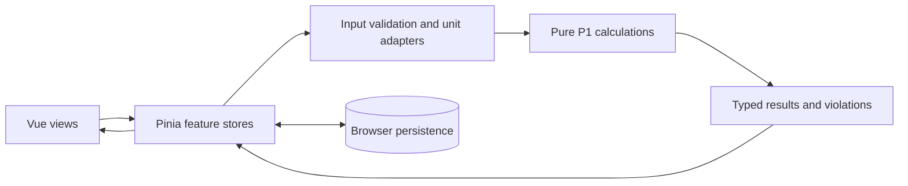

# AeroDash architecture

AeroDash is a frontend-only Vue 3 PWA using strict TypeScript, Pinia, Vue Router and Vite. Aircraft profiles persist in IndexedDB; active preparation payload and preferences also use browser storage. See [data rights](docs/architecture/data-rights.md) and [PRIVACY.md](PRIVACY.md) for the concrete storage surface. No backend is required by the current app.

## Data flow and boundaries

| Tier | Location | Responsibility |
| :--- | :--- | :--- |
| P1 | `frontend/src/core/` | Zod schemas, domain contracts, units and deterministic M&B/performance/fuel logic |
| P2 | `frontend/src/modules/` | Aircraft and preparation features, stores and input/output adapters |
| P3 | `frontend/src/shared/`, global `stores/`, `plugins/`, `router/`, app views | Navigation, shared components and application services |

P1 imports only core, standard-library APIs and Zod. It returns typed results; upper layers render warnings and enforce acknowledgement. P2 must not depend on shell implementations. See [dependency isolation](docs/architecture/adr/314-DEV-dependency-isolation.md) and [contributor rules](AGENTS.md).

## Local profiles and preparation

[Aircraft model](docs/architecture/aircraft_data_model.md), [fleet module](docs/architecture/aircraft-fleet-module.md) and [exchange contract](docs/architecture/aircraft-exchange-file-format.md) describe schema validation, immutable verified snapshots, draft edits, provenance/expiry and import/export boundaries. [Optional occupancy](docs/architecture/optional-occupancy.md) distinguishes a legitimate empty seat from invalid or missing occupant mass.

Profiles preserve manufacturer source units. [Performance source units](docs/architecture/performance-source-units.md) are declared per table and axis independently of M&B; original points persist and the pure adapter normalizes copies for review and lookup. Adapters normalize values to the internal calculation frame (kg, m, L, s as applicable); pressure-altitude lookup uses ft and temperature uses °C under its explicit contract. Calculations must not mix units implicitly. The original POH/weighing report remains authoritative.

## Numerical contracts and evidence

- [M&B requirements](docs/requirements/mass_balance.md) cover category limits, CG/envelope checks, variable station moments and fuel-burn migration.
- [Interpolation](docs/architecture/performance-bilinear-interpolation-contract.md) defines the regular-grid lookup, clamping flags and hand-computed test vectors.
- [Extrapolation](docs/architecture/performance-extrapolation-control.md) defines the 10% cap, single 20% penalty, minimum-distance floor and acknowledgement boundary.
- [Safety-factor pipeline](docs/architecture/performance-safety-factor-pipeline.md) defines ground versus airborne correction, presets, margins and failures. Preset names are software behavior, not a claim that a factor is applicable to every operation.
- [Notifications](docs/architecture/notification_schema.md) separate input-validation ERRORs from flight-limit CRITICALs.

Core source/tests do not prove an integrated UI path or operational data validity. The P2 Performance inspection service validates persisted profiles, complete positive grids, decimal input and the common envelope before invoking the core; any clamping blocks output. Fleet exposes imported points for review. [Manual runway entry](docs/architecture/manual-runway-entry.md) stores pilot-declared runway values offline for source-limited performance comparisons. [Pressure altitude](docs/architecture/pressure-altitude.md) is entered directly or derived from QNH and field elevation by explicit pilot choice. [Shared Flight Prep Performance](docs/architecture/performance-flight-prep.md) reuses current takeoff and trip-arrival masses with independent raw phase results. Weather preparation remains unfinished; see the [roadmap](docs/development/roadmap.md). Preserve [source constants](docs/data_constants/README.md), [assumptions](ASSUMPTIONS.md), [hazards](docs/risk_management/safety_hazards.md) and [reference testing](docs/testing/TESTING.md).

## Trip arrival estimate

Both manual fuel modes use the current validated M&B takeoff mass and moment in SI.
The P2 fuel adapter counts every category-available tank, including empty tanks, and
normalizes its explicit fixed arm through the existing source-unit boundary. One tank without lookup geometry supports CG directly; multiple tanks require an
explicit existing named sequence. The legacy `BurnSequenceEntry` contract stores
`sequenceName` and `ordinalPosition` on each fuel tank. M&B migration collects the
union of names, sorts participating tanks by their first matching ordinal, and
computes intermediate full-tank endpoints. It does not enforce complete membership
or unique entries/positions; that behavior is unchanged.

Trip arrival validates the selected name separately: every category-available tank
(including empty tanks) must carry exactly one matching entry with a distinct finite
positive integer ordinal. Gaps are allowed; order is numeric. Matching entries on
category-excluded tanks invalidate a multi-tank sequence. Names are exact identities.
The selector presents existing names without a default, so invalid schedules can be
selected but produce a visible reason. Aircraft/category/profile changes clear the
selection; load/input changes recompute it. Method changes and reload reset it.

P1 drains usable loaded mass in order up to the trip burn, subtracting each burned
moment in SI. Shared inventory conversion supplies each tank's usable mass; unusable
fuel stays in BEM and reserve remains aboard. Unsupported CG configurations retain
valid arrival mass with a reason. No schedule is inferred.

A single category-available lookup tank is supported only with `arm: null` and
exactly zero unusable fuel. Imported lookup moments are total tank moments at each
load, so P1 subtracts F(q) − F(q − b) from the current takeoff moment, interpolating
moments (never arms) with the same segment rule as M&B. P2 rejects raw negative/nonfinite knots before
normalization clamps them, then normalizes the axis like tank loads and moments with
the profile mass × length unit; P1 requires ≥ 2 strictly ascending knots from exactly
(0, 0), coverage of [0, q] and the existing SI bounds. Nonzero-unusable arrival CG stays
unsupported (arrival mass is kept). The estimate is separate
from the all-usable-burned M&B endpoint and does not assess landing suitability or
the full burn path/envelope. Synthetic arithmetic and browser tests establish
software wiring only.

## Fuel lower boundary

All category-available fuel tanks require finite nonnegative total load q and
unusable quantity u, with q ≥ u checked in the entered tank unit before normalization.
Raw tank checks run even when the weighing report is missing, retaining both blockers
and independent draft, occupant and station notices. Reportless states do not normalize
inputs or invoke calculation; adapter-dependent geometry and computed limits remain excluded.
Invalid raw input clears the current result and marks the tank with a reason and
minimum quantity. Typed q < u is retained for correction; q = u contributes no
usable mass or moment, since BEM already includes unusable fuel. Correction never
changes BEM, source units or profile geometry. The same result boundary suppresses
summary, chart markers, trip arrival and an already open print snapshot.

## Lookup fuel tanks in M&B

A fuel lookup table holds the total tank moment F at each total tank load. Unusable
fuel u is part of BEM, so a tank at current load q contributes mass q − u and moment
F(q) − F(u); fixed arms still contribute (q − u) · arm. Non-fuel lookup stations keep
the legacy arm lookup. The P2 store first checks raw values (explicit source unit,
tank unit and known fuel types, finite nonnegative knots, q ≥ u) before
normalization can clamp or fall back. The P1 adapter then requires ≥ 2 finite knots
with strictly ascending quantities in SI bounds, coverage of u and q without
sorting, clamping, extrapolation or an invented origin, and a bounded difference;
signed and nonmonotonic moments are valid. Arm plus lookup is `NOT_ALLOWED`. Any
failure emits `ERR-SYS-001` and leaves no result, so chart markers, summary, fuel
arrival and print are blocked rather than stale. Takeoff, named-sequence waypoints
and envelope checks (arm and moment graphs) use the corrected contribution; the
all-usable-burned endpoint remains the zero-fuel point. Endpoints and straight
segments do not validate a nonlinear full-flight path.

## Current briefing pack

The P2 export module snapshots current M&B loading/results/notifications, fuel
presentation and the shared Performance presentation from live getters. It does
no safety calculation or DOM scraping. Limits use the existing SI adapters;
the printed chart reuses CGEnvelopeChart with normalized envelope/result data,
a white-background palette and distinct SVG definition IDs. Named MTOM/MZFM
limits sit beside their applicable calculation rows. Aircraft identity and
per-value unverified markers remain; a separate source-status chapter is omitted.

The pack automatically includes current fuel and Performance sections. Invalid
or unconfigured fuel retains current inventory and an explicit reason while
suppressing successful trip/endurance outputs. Performance inputKey changes
invalidate the whole snapshot, including unsaved runway/condition changes. An
unavailable landing result does not erase independently valid takeoff results.
The persistent action shares the homepage primary CTA styles and reserves content
space above mobile navigation and its safe area. It is natively disabled and grey
when M&B is ineligible, with no associated helper text or tooltip. Calculation
warnings remain at affected values. Performance remains a homepage and internal
Flight Preparation entry with a standalone deep link, outside top-level navigation.

Export eligibility checks successful finite computation, current profile/input identity
and hard failures separately from advisory severity. Only known computed M&B
limit exceedances cross the critical-state gate; errors, unknown criticals and
invalid computation remain blocked. This replaces the previous severity-only
restriction. Exact warnings accompany affected mass/CG, station, fuel-budget and
QNH-derived distance values. Printed SVG preserves critical color and crosshatching,
including when browser print backgrounds are disabled.

Opening, Print click and beforeprint check live eligibility. Source changes
synchronously invalidate the snapshot and set a DOM/CSS guard before queued Vue
renders can expose stale numbers to native printing. The snapshot fingerprint
is reactive so a new current snapshot can be opened after invalidation.
Cancellation preserves inputs. Browser printing needs no upload or PDF library.

## Application lifecycle

[PWA lifecycle](docs/architecture/adr/316-pwa-update-lifecycle.md) permits silent updates only for a classified cold start; active-session updates need consent. A failed session-storage check uses the consent path. Online minimum-safe-version checking can block unsafe versions; offline use cannot obtain a fresh remote safety verdict.

The app exposes local data erasure/export and a [contribution handoff](docs/architecture/adr/013-in-app-contribution-intake.md) to GitHub. Cloud/OIDC/organization sync is future scope and must pass the [pre-sync engineering gate](docs/architecture/adr/014-pre-sync-privacy-gate.md) before implementation. No fake API endpoint contract is published for unimplemented services.
