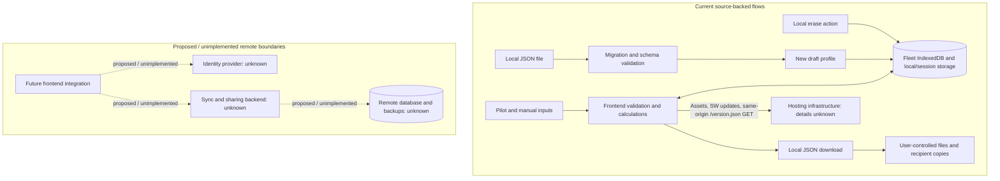

# ADR-014: Pre-sync privacy engineering gate

- **Status:** Accepted engineering prerequisite, subject to one independent review and merge.
- **Date:** 2026-11-17
- **Owner:** CTO (engineering gate and evidence intake).

## Decision and limits

Hold implementation of OIDC, cloud synchronization, network Share-Code services
and organization synchronization until the CTO records release of this gate for
the concrete processing operation. Documentation and local product work may
continue. Preserve offline/manual preparation, calculations, local fleet storage,
local JSON export/import and local data erasure without an account or cloud.
Reconnection or upgrade must not silently upload existing local records.

This ADR is an internal engineering prerequisite. It is not a completed DPIA,
lawful-basis approval, legal-compliance finding or deployed sync feature.
[Issue #285](https://github.com/naturelle137/AeroDash/issues/285) remains **OPEN**:
its full DPIA Definition of Done is unmet. A conditional risk record or a merged
ADR alone does not satisfy that acceptance boundary. No runtime activation,
provider choice, endpoint contract or privacy-notice change is introduced here.

## Current source evidence and dataflow

Baseline: `6f56afbbb4ef276ce55eb841d071a3746cbf35ea` (`origin/develop`),
inspected 2026-11-17. These are source observations, not a live deployment capture.
The current architecture is frontend-only; the sync module contains only
`.gitkeep`. No backend, OIDC, network Share-Code or organization-sync consumer is
implemented in the inspected tree. External hosting infrastructure was not inspected.

| Current evidence | Actual data and limits |
| --- | --- |
| [Profile schema](../../../frontend/src/core/adapters/aircraft.schema.ts), [fleet store](../../../frontend/src/modules/aircraft/stores/fleet.store.ts), [repository](../../../frontend/src/modules/aircraft/services/fleet.repository.ts) | Fleet profiles persist in IndexedDB. Data can include registration/technical values, passenger names/standard weights/units, verifier/date/POH provenance, costs and free text. `ownerId` is a nonempty string, with a local UUID fallback when absent/blank; `shareCode` is a nullable string. Neither establishes authenticated identity, sharing, expiry or authorization. |
| [Session schema](../../../frontend/src/core/domain/session.schema.ts), [session persistence](../../../frontend/src/stores/session-persistence.store.ts), [local storage surface](../data-rights.md) | Aircraft/category, station weights, flags and save time persist locally; runway, UI/unit preferences and disclaimer/session markers also use browser storage. Preparation and calculations have no cloud dependency. |
| [Single exchange](../../../frontend/src/modules/aircraft/services/profile.import.ts), [fleet import](../../../frontend/src/modules/aircraft/services/fleet.import.ts), [exchange format](../aircraft-exchange-file-format.md) | Single export uses the `aerodash-aircraft` versioned envelope; the default strips operating costs only. Owner/share strings, passengers and verification can remain. Bulk export contains readable full profiles including costs and reports omitted unreadable records. Imports validate/migrate, assign new profile IDs, force draft status and remove verification; validated owner/share strings, passengers and costs can survive. Local exchange is not anonymization or network sharing. |
| [Data-rights service](../../../frontend/src/modules/aircraft/services/data-rights.service.ts), [Privacy view](../../../frontend/src/views/PrivacyView.vue) | Erasure clears fleet records and AeroDash-namespaced local/session storage, cancels pending session save and reports observed partial failures. It does not delete downloaded backups, other-device/recipient copies, app-version IndexedDB or PWA CacheStorage. An unavailable storage accessor is treated as empty; intermittent inaccessibility remains a limitation. Bulk export is not every browser storage facility. |
| [Remote version check](../../../frontend/src/stores/app-version.remote.ts), [version cache](../../../frontend/src/stores/app-version.cache.ts), [PWA configuration](../../../frontend/vite.config.ts), [logger](../../../frontend/src/shared/utils/logger.ts) | Same-origin `/version.json` GET omits credentials/referrer/body; app assets and service-worker updates also generate requests. Hosting can receive IP/User-Agent metadata. Actual provider, deployment, access logs and retention are unknown. Version metadata and resource caches are separate stores. Logging uses console; development telemetry is not evidence of a production collector. |

Names, weights and verifier identifiers can relate to people; registrations and
owner strings can be linkable. Technical aircraft values are not automatically
personal data, and weight alone does not establish health data. Actual context
controls that assessment. Existing notice assertions about private/local use do
not approve future cloud/club processing.

Future categories could include OIDC subjects/scopes/tokens, accounts,
organization memberships/roles, recipients, sync versions/deletion markers and
access logs. Flight-plan server storage is included only if actually proposed;
it is not current implementation. Local storage/JSON has no application-layer
encryption; device encryption is unknown. No end-to-end encryption is claimed.

## Unknown inputs and evidence required for gate release

All future facts below are **UNKNOWN**. Technical preferences are proposed and
need concrete facts, accountable decisions and later implementation evidence.
The CTO owns collection; the actual accountable controller must be identified
rather than inferred from a repository author, CEO title or `ownerId`.

| Input | Required evidence and decision owner |
| --- | --- |
| Controller/processor/subprocessors | Actual legal entities, purposes/means per operation, joint-controller relationships if any, processor instructions and applicable processor terms/contracts. Accountable operator with CTO intake. |
| Deployment/provider/region/transfers | Identity/hosting/storage/support providers, jurisdictions, regions, access/transfer routes and applicable safeguards. Operator and engineering. No provider or region is selected here. |
| Purposes/people/data/minimisation | Operation-specific purpose, data subjects, scale, categories, necessary field-level payloads, recipients and default accessibility. Controller with engineering. Do not upload the current full export by default merely because it exists. |
| Purpose-specific lawful basis | Applicability and Article 6 rationale for each operation, Article 9 assessment where relevant, notices and rights handling. Controller; no basis or household exemption presumed. |
| Retention/deletion | Active/replica/log/backup durations and purge deadlines, backup deletion, offline tombstones/replay, revocation propagation and incomplete-deletion reporting, including copied-export limits. Operator and engineering; no durations are selected. |
| Crypto/key ownership | Proposed authenticated encrypted transport; threat-based local/server/export/backup at-rest controls, key custody/access/rotation/recovery and incident response. Security/engineering with operator; no cipher, key policy or E2EE promise selected. |
| Share-Code threats and lifecycle | Explicit publication, minimised payload, recipient access, token entropy, guessing/leak/replay defenses, finite TTL/expiry clock and revocation including copies. Engineering; no entropy or TTL value invented. |
| Auth/organization boundaries | Identity binding, membership/role authority, workspace segregation, server authorization, conflict semantics and account/token lifecycle. Engineering with controller. Imported owner strings cannot authorize access. |
| Logs and processor terms | Actual event fields, collection/access purposes, recipients, minimisation, retention, deletion and applicable processor/subprocessor arrangements. Operator with security; source inspection cannot establish deployment behavior. |
| Risk and DPIA disposition | Actual scope/context/scale, necessity/proportionality, affected people, likelihood/severity, controls, residual risk and accountable owner; applicable authority lists and Article 35 screening once jurisdiction is known. Controller with CTO evidence; full DPIA required to meet unchanged #285 acceptance, and Article 36 route if triggered. |

## Conditional risk record

These are risk paths to assess against the future operation, not established
vulnerabilities or measured low/high risk. Likelihood, severity and residual
acceptability remain undetermined for lack of the facts above. Aviation safety
relevance alone does not establish a privacy high-risk determination.

| Risk path and possible harm | Candidate mitigation | Missing evidence |
| --- | --- | --- |
| Shared/lost device or XSS reads profiles/exports; passenger or financial disclosure. | Minimise fields/access; evaluate device, application and at-rest protection. | Device/trust model, actual payloads, key custody and security verification. |
| Misdirected JSON or leaked/guessed Share-Code exposes identifiable people or costs. | Explicit publish preview, necessary payload only, access controls, entropy/rate limits, expiry/revocation. | Recipient model, token design, lifetime and tested revocation/copy semantics. |
| Forged imported owner string or cross-org request discloses/changes another workspace. | Bind authenticated subject/roles to server-side authorization; distrust imported ownership. | Identity provider, membership authority, isolation design and boundary tests. |
| Logs/backups retain erased data or offline replay resurrects it. | Minimise logs; bounded retention/purge, tombstones and deletion propagation with honest partial results. | Storage topology, retention contracts, backup restoration and reconnect/deletion evidence. |
| Org conflict replaces the pilot's local preparation context. | Review conflict/provenance presentation and preserve independent manual/offline work. | Actual sync/conflict design, privacy and flight-preparation impact assessment. |

The CTO retains the hold until operation-specific evidence resolves the inputs,
records necessary controller decisions and risk ownership, and meets #285's full
DPIA and reviewed/merged prerequisite acceptance. Proposed controls require later
functional/security evidence; this document does not claim those controls passed.

## Exact reopening event and consequences

Reopen only when a concrete processing proposal supplies the actual entities,
deployment/transfer map, purposes/subjects/scale, minimised payloads, lawful-basis
rationale, retention/deletion model, crypto/key plan, sharing/auth boundaries,
logging/contracts and risk/DPIA evidence above. Record the changed facts and
source versions, then the CTO decides the gate disposition with the accountable
controller. Missing applicable inputs keep covered remote code on hold. A later
material change in those facts reopens assessment before the affected processing.
There is no timer, polling chain or automatic expiry. Existing issue, source,
security and physical-device holds remain unchanged.

This finite increment permits useful local work and documents an honest stop
condition. It creates no accounts, backend, service activation or blanket block
on local preparation. Review and merge remain required before this engineering
prerequisite becomes integrated policy.

## Official sources

The following three sources were checked on 2026-11-17. This ADR applies them as
an engineering gate; it makes no processing-specific legal determination.
Revalidate applicability and versions when the concrete processing is supplied.

1. [Regulation (EU) 2016/679 (GDPR)](https://eur-lex.europa.eu/legal-content/EN/TXT/?uri=CELEX:32016R0679), adopted 27 April 2016, OJ L119, 4 May 2016. Binding regulation: scope/definitions Arts. 2–4; principles/basis Arts. 5–6; special categories Art. 9; rights Arts. 12–20; accountability/design/roles Arts. 24–28; records/security Arts. 30/32; DPIA/consultation Arts. 35–36; transfers Arts. 44–49. Likely high risk requires prior DPIA; screening is not its completion. The research consolidation dated 4 May 2016 is documentary, not the binding act.
2. [EDPB Guidelines 4/2019, v2.0](https://www.edpb.europa.eu/system/files/documents/files/file1/edpb_guidelines_201904_dataprotection_by_design_and_by_default_v2.0_en.pdf), adopted 20 October 2020. Final supervisory guidance, not legislation. Sections 2.1.3.4, 2.1.4 and 2.2 explain case-specific risk, design-time review and minimisation of amount, extent, storage and accessibility. They support the proposed defaults and evidence gate, not a completed DPIA.
3. [EDPB Guidelines 07/2020, v2.1](https://www.edpb.europa.eu/system/files/documents/2023-10/EDPB_guidelines_202007_controllerprocessor_final_en.pdf), adopted 7 July 2021, minor corrections 20 September 2022. Final supervisory guidance, not legislation. Part I §1 paragraph 12, §§2.1.2/2.1.4, §§3–4 and Part II §1 explain functional controller/processor roles and their arrangements. Future roles require actual purposes/means and relationships.
