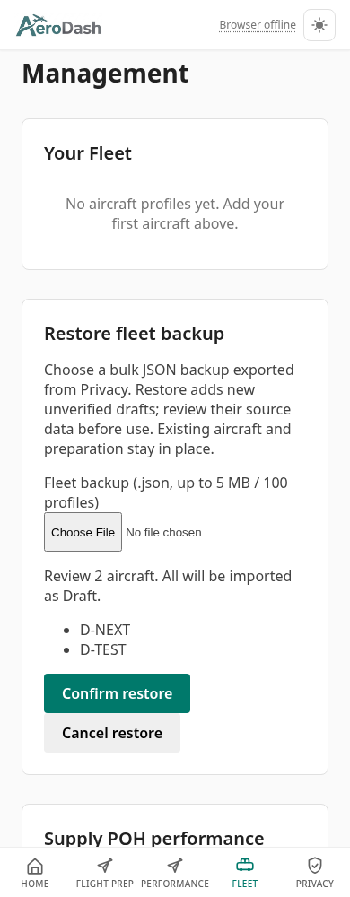
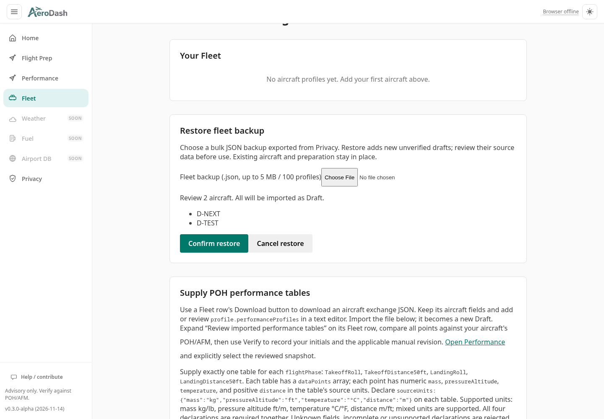

# Offline fleet backup restore

Synthetic software checks for #519; no operational POH/AFM validation.

The production Chromium run at 390 and 1440 pixels exports two synthetic
profiles through Privacy, explicitly wipes only that isolated browser context's
test data, restores through Fleet after a cached offline reload, compares every
persisted field (except fresh IDs), reloads offline, reviews declared units and
source references, and selects the imported draft with its warning.

Cancel, conflicting registrations, malformed/future envelopes, mismatched counts,
duplicate registrations and invalid/future profiles preserve the persistent fleet.
A separate browser case enters 85 kg in real M&B preparation, cancels a preview,
then aborts a native IndexedDB transaction after its second successful add request.
The old fleet and saved preparation remain intact; retrying the same preview
succeeds and the preparation still shows 85 kg / 585 kg total mass. This injects
a storage abort; it does not exhaust the device's real storage quota.
Integration cases also inject a later quota exception, a duplicate-key request
failure, a conflict after preview and a conflict with an unreadable stored row.

## Checks

All commands ran inside `web-dev` with the frozen lockfile installation.

| Check | Result |
| :---- | :----- |
| `pnpm install --frozen-lockfile` | Passed |
| `pnpm lint` | Passed |
| `pnpm test:unit` | 2027 passed |
| `pnpm test:integration` | 166 passed |
| `pnpm build` (includes typecheck) | Passed |
| `CI=1 pnpm test:e2e --project=chromium --workers=2 --reporter=line` | 97 passed |
| Production `playwright.offline.config.ts`, both widths | 12 passed, including four restore cases |

The new tests live in `fleet.import.spec.ts`, `fleet.restore.int.spec.ts` and
`tests/offline-production/fleet-restore.spec.ts`. CI uploads the actual Privacy
exports, restored rows, screenshots and traces as `offline-workflow-evidence`.
The implementation job also retains logs, source/dist/runtime SHA-256 manifests
and traces in `agent-hq/var/jobs/1138/evidence/` for the terminal acceptance owner.
Earlier harness failures omitted the normal draft acknowledgement or left the
previous expanded review panel open during a later scroll; the final run passes
without retries after explicit acknowledgement and collapsing each reviewed row.

## Browser captures

| Width | Preview | Preserved sources | Storage rollback and retry |
| :---- | :------ | :---------------- | :------------------------- |
| 390 | [Preview](preview-390.png) | [Units and reference](source-review-390.png) | [Failure retains preview](rollback-390.png) |
| 1440 | [Preview](preview-1440.png) | [Units and reference](source-review-1440.png) | [Failure retains preview](rollback-1440.png) |

