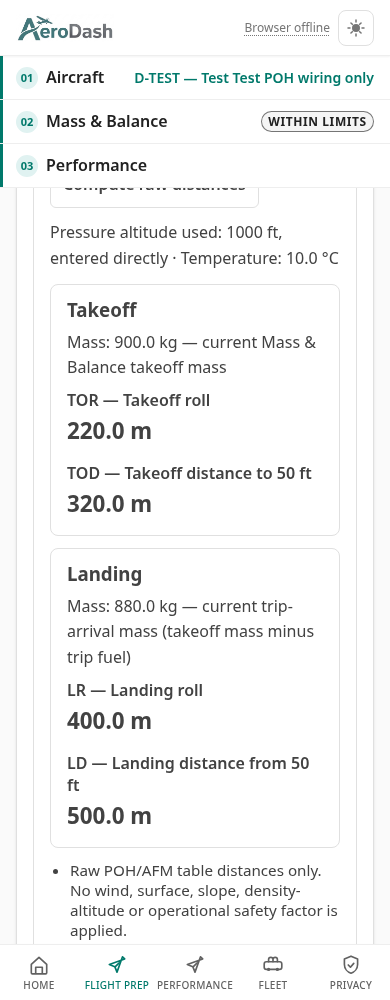
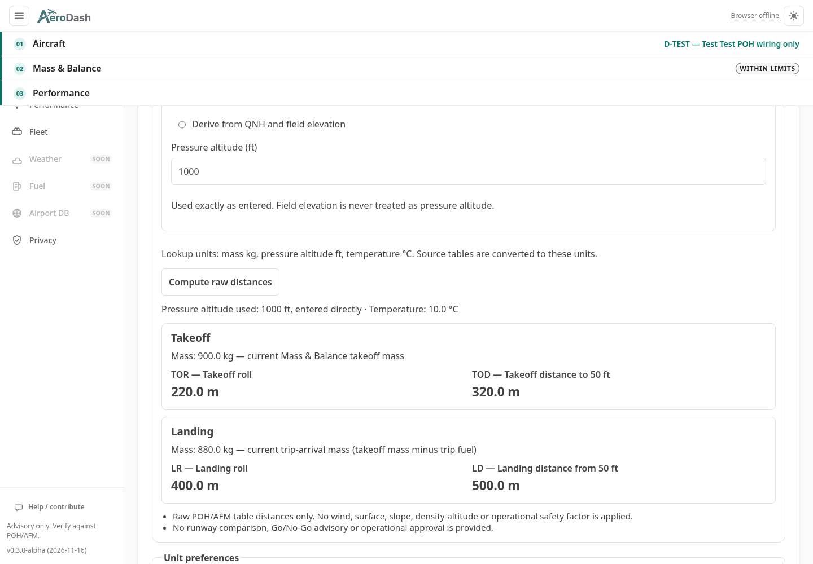

# Flight Prep Performance evidence

2026-11-16, Chromium, production service-worker cache; synthetic Test aircraft.
These vectors prove software wiring, never operational POH/AFM accuracy or approval.

## Executed checks

All commands ran in `web-dev` at the repository root. No `@wip` scenario counts as
passed. Current source is the implementation in this PR; integration/whole-pack
acceptance remains with the delivery owner after independent review.

| Check | Command / source | Result |
| :--- | :--- | :--- |
| Lint | `pnpm lint` | Passed |
| Unit | `pnpm test:unit` | 108 files, 2259 tests passed |
| Integration | `pnpm test:integration` | 22 files, 200 tests passed |
| Build and typecheck | `pnpm build` | Passed |
| P1 isolation and per-file coverage | `pnpm --filter frontend test:p1:coverage` | Passed; aggregate lines 99.35%, branches 97.39% |
| P1 mutation | `pnpm --filter frontend test:mutation` | 79.90%; required floor 70 |
| Full Chromium BDD | `CI=1 pnpm test:e2e --project=chromium --workers=4 --retries=0` | 97 passed |
| Full cached-offline suite | `pnpm --filter frontend exec playwright test --config playwright.offline.config.ts` | 28 passed at 390/1440 px |
| Changed browser workflows after aircraft-placeholder correction | Above Playwright command with `flight-prep-performance` filter | 4 passed at 390/1440 px |

Full browser suites include the scientific-notation conversion fix. The final
aircraft-placeholder display correction was then checked by the changed workflows
against a fresh production build. The PR CI
runs the full Chromium and cached-offline suites again at its final head.

## Slice A acceptance

| Behaviour | Evidence |
| :--- | :--- |
| Current selected aircraft/category; no second profile or mass entry | Production browser workflow; screenshots |
| Takeoff 900 kg, trip arrival 880 kg; distances 220/320 and 400/500 m | Independent synthetic formula in browser fixture |
| Missing/invalid arrival retains valid takeoff, never substitutes fuel-burn endpoint | Browser workflow and `flight-prep-masses.spec.ts` |
| Exact/intermediate/min/max/capped/above-max and nonfinite masses | Core phase lookup, service and browser tests |
| Normalized lb tables and differing phase envelopes | Service tests and source-unit BDD vectors |
| Draft/expired/missing grids | Service tests, BDD and real aircraft-switch browser case |
| Payload/fuel/method/category/profile/runway/conditions/units invalidate results | Integration input-key tests and browser workflows |
| Empty aircraft placeholder preserves displayed identity and current loading | Browser workflow |
| hPa/ft/m fallback and explicit persisted overrides | Browser defaults, saved declaration/reload, invalid preference case |
| Physical conversion including `1e3` ft to 304.8 m | Core, integration and actual browser field conversion |
| Numeric PA/QNH reset; derived/direct paths agree within display precision | Browser reload/conversion and existing independent PA vectors |
| Current typed presentation including unavailable operational sources | Shared composable integration tests; source-assessment BDD |

The below-minimum mass cap uses the minimum-mass table boundary only for
nondecreasing rows and in-range PA/temperature. It does not establish aircraft
applicability below the manual range. All upper mass excursions and lower/upper
PA/temperature excursions remain blocked; no +10% extrapolation band is enabled.
Operational factors, runway comparison and source acquisition remain unavailable.
See [the policy and limitations](../../../architecture/performance-flight-prep.md).
The complete briefing pack/print redesign is the next slice; it is not accepted
by these Performance screenshots or by existing native-print regression tests.
